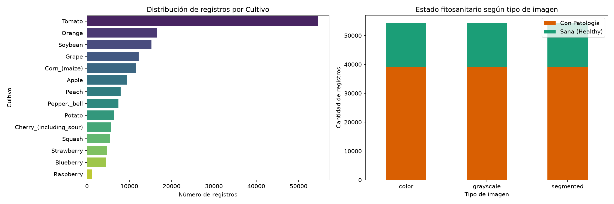

# Entrega 1 — Python: Fuentes de datos, EDA y limpieza

- **Proyecto:** AgroSmart Predict
- **Código ejecutable:** [`notebooks/01_eda_limpieza.ipynb`](../../notebooks/01_eda_limpieza.ipynb)
- **Instrucciones de datos:** [`data/README.md`](../../data/README.md)

---

## 1. Qué datos necesitamos y para qué
Tras evaluar las alternativas de la Actividad 0, elegimos **AgroSmart Predict** con el dataset `mohanty/PlantVillage` por su disponibilidad inmediata, acceso abierto sin bloqueos legales y alto volumen de registros reales (`162.916` muestras). Para abordar la detección temprana y análisis de incidencias fitosanitarias en cultivos necesitamos registros estructurados que asocien especies agrícolas con sus patologías foliares más frecuentes:
- **Datos confirmados (muestra obtenida):** Catálogo completo de `mohanty/PlantVillage` en Hugging Face (`162.916` registros repartidos en `train` y `test`), del cual extraemos la especie de cultivo, el diagnóstico de enfermedad, el estado sano/enfermo y el tipo de procesamiento de imagen.
- **Datos pendientes / limitaciones detectadas:** Esta versión del dataset en Hugging Face almacena las rutas jerárquicas y etiquetas del catálogo (`text`), pero no incluye directamente los tensores de píxeles ni variables agroclimáticas de campo (temperatura, humedad o rendimiento por hectárea). En fases posteriores (SQL / ML) se valorará cruzar estos indicadores con fuentes meteorológicas o descargar el paquete binario de imágenes si el modelo final requiere visión artificial directa.

---

## 2. Ficha de la fuente: `mohanty/PlantVillage`

- **Origen y acceso:**
  - *Proveedor:* Repositorio público en Hugging Face (`mohanty/PlantVillage`), basado en el proyecto académico PlantVillage (Penn State University).
  - *Enlace:* https://huggingface.co/datasets/mohanty/PlantVillage
  - *Método de obtención:* Descarga automatizada en Python mediante la función `load_dataset("mohanty/PlantVillage", "default")` de la librería `datasets`. No requiere credenciales ni API Key.
  - *Formato:* DatasetDict de Hugging Face exportado a CSV sin modificar en `data/raw/plantvillage_raw.csv`.
  - *Pasos para reproducir:* Ejecutar las celdas de `notebooks/01_eda_limpieza.ipynb` con conexión a internet.

- **Condiciones de uso:**
  - *Licencia y condiciones:* El dataset PlantVillage fue publicado originalmente bajo dominio público / licencia abierta para investigación académica y desarrollo de herramientas agrícolas (ver ficha en https://huggingface.co/datasets/mohanty/PlantVillage).
  - *Uso y redistribución:* Permite su descarga, transformación y análisis con fines académicos no comerciales. Para mantener el repositorio ligero y respetar buenas prácticas, no se suben los ficheros CSV completos a GitHub, sino el código reproducible que los genera automáticamente.

- **Protección y privacidad:**
  - No contiene datos personales, sensibles ni confidenciales de agricultores ni explotaciones privadas (únicamente rutas internas de clasificación botánica y fitosanitaria).
  - No existen restricciones de RGPD; los resultados agregados y gráficos pueden publicarse libremente en el repositorio.

- **Frecuencia y cobertura:**
  - *Frecuencia:* Dataset histórico estático (no tiene actualización periódica ni en tiempo real).
  - *Cobertura:* Abarca múltiples especies agrícolas (tomate, naranja, soja, uva, maíz, manzana, patata, frambuesa, etc.) y decenas de patologías fúngicas, bacterianas y víricas, además de muestras sanas.
  - *Adecuación al producto:* Es idóneo para construir la base taxonómica de cultivos y patologías, entrenar modelos de clasificación o análisis de prevalencia de enfermedades, aunque no sirve por sí solo para monitorización meteorológica en tiempo real.

- **Granularidad y variables:**
  - *Unidad de registro (fila):* Una imagen catalogada de una hoja de cultivo en una variante específica (`Color`, `Grayscale` o `Segmented`).
  - *Identificadores:* Clave compuesta por (`tipo_imagen`, `cultivo`, `enfermedad`, `nombre_archivo`).
  - *Variables principales:* `nombre_archivo` (string), `split` (string: `train`/`test`), `tipo_imagen` (string), `cultivo` (string), `enfermedad` (string), `es_sana` (boolean) y `ruta_original` (string).

---

## 3. EDA básico e inspección de calidad

Al inspeccionar la muestra completa descargada (`129.783` filas en `train` y `33.133` filas en `test`; `162.916` filas en total):
- **Estructura original:** El dataset original solo contiene una columna (`text`) con rutas tipo `Raw/Color/Raspberry___Healthy/A37F34F7-022D-46...`. Fue necesario parsear esa cadena por `/` y `___` para obtener variables analizables.
- **Valores ausentes y formatos:** Se verificaron `0` valores nulos en `text` y se comprobó que `0` registros presentaban una estructura de carpetas distinta a 4 niveles.
- **Duplicados:** Se detectaron `0` registros duplicados exactos.
- **Distribución y desbalanceo de clases:** Como muestra el gráfico exploratorio, existe un fuerte desbalanceo entre cultivos (*Tomato* concentra `54.480` registros, seguido de *Orange* con `16.521` y *Soybean* con `15.270`, frente a cultivos minoritarios como *Raspberry* con `1.113`). Asimismo, predominan las hojas con patología frente a las hojas sanas (`27,78 %` sanas frente a `72,22 %` enfermas). Por último, el catálogo triplica registros al incluir variantes `Segmented` (`54.306`), `Color` (`54.305`) y `Grayscale` (`54.305`), lo cual deberá filtrarse en SQL (Actividad 2) para no contar tres veces la misma hoja.

---

## 4. Pipeline de limpieza con Python

El pipeline implementado en `notebooks/01_eda_limpieza.ipynb` ejecuta de forma lineal:
1. **Carga:** Descarga los splits `train` y `test`, los unifica preservando `split` y guarda `data/raw/plantvillage_raw.csv` intacto.
2. **Transformaciones:**
   - Limpia espacios en blanco extremos (`.str.strip()`) sin modificar las mayúsculas de los UUID de archivo para no romper la trazabilidad con el fichero original.
   - Descompone la ruta en `tipo_imagen`, `cultivo`, `enfermedad` y `nombre_archivo`, y crea la variable booleana `es_sana`.
   - Normaliza las cadenas de `cultivo` y `enfermedad` sustituyendo guiones bajos (`_`) por espacios.
   - Filtra rutas mal formadas (si las hubiera) y elimina duplicados exactos.
3. **Validación:** Ejecuta aserciones automáticas (`assert`) verificando 0 nulos, 0 duplicados por clave compuesta y tipos de datos correctos.
4. **Salida:** Exporta el resultado limpio a `data/silver/plantvillage_silver.csv` manteniendo el máximo detalle para su posterior modelado en SQL.

---

## 5. Resultados y conclusiones (Antes vs. Después)

| Métrica / Aspecto | Capa Raw (Original) | Capa Silver (Limpia) | Acción realizada |
| :--- | :--- | :--- | :--- |
| **Número de filas** | 162.916 | 162.916 | Verificadas 100 % válidas sin pérdidas |
| **Número de columnas** | 2 (`text`, `split`) | 7 columnas estructuradas | Parseo jerárquico de ruta y creación de `es_sana` |
| **Valores nulos** | 0 | 0 | Verificado mediante control de calidad (`assert`) |
| **Duplicados** | 0 | 0 | Verificados 0 duplicados por clave compuesta |
| **Consistencia textual** | Rutas crudas con `___` | Categorías limpias y tipadas | Normalización de texto sin alterar UUIDs |

### Viabilidad y limitaciones para AgroSmart Predict
- **Viabilidad:** Confirmada para construir el catálogo estructurado de cultivos y enfermedades, analizar prevalencias en SQL/Estadística y entrenar clasificadores.
- **Limitaciones y sesgos:**
  1. **Sesgo de laboratorio:** Las imágenes de PlantVillage fueron tomadas en condiciones controladas con fondo uniforme, por lo que un modelo entrenado solo con ellas puede perder precisión en fotos reales tomadas a pie de campo.
  2. **Ausencia de variables ambientales:** El dataset no contiene datos climáticos ni de suelo. Para que **AgroSmart Predict** prediga riesgo de aparición de plagas antes de que la hoja muestre síntomas, será recomendable integrar en la fase de SQL (Actividad 2) una segunda fuente meteorológica histórica cruzada por cultivo/región.